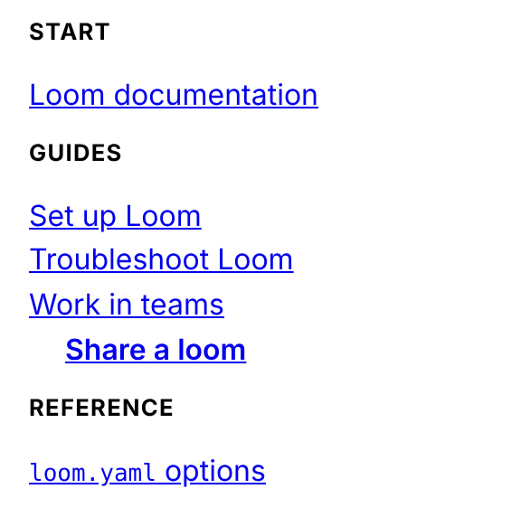
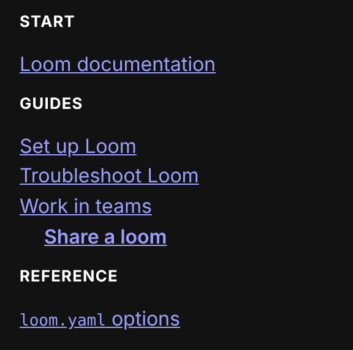

Each build's site output has its share of the project's [navigation](../navigation/index.md) (SPEC §7.8) as `_ascribe/nav.json`, beside the page records (output-layout contract §1.6). `@ascribed/astro`'s `sidebar()` and `neighbors()` read it; a site built another way can too. The JSON output has the same file at the same path, with each formatted label in that output's form. This contract says what the file holds and what a reader can rely on.

| Who | Uses this contract to |
|---|---|
| `ascribe build` | Write the file, for every build, in the site output and the JSON output |
| `sidebar()` and `neighbors()` in `@ascribed/astro`, or a site of your own | Draw a sidebar and link each page to its previous and next, joining each page to its collection entry or record |

## 1. The file

```json
{
  "version": 1,
  "root": {
    "folder": "",
    "label": "Start",
    "page": { "source": "index.md", "label": "Loom documentation", "type": "page" },
    "pages": [],
    "sections": [
      {
        "folder": "checks/",
        "label": "Checks",
        "page": { "source": "checks/index.md", "label": "Checks", "type": "concept" },
        "pages": [
          { "source": "checks/diagnostics.md", "label": "Diagnostics", "type": "reference" },
          {
            "source": "checks/vale.md",
            "label": "Checking prose with Vale",
            "formatted": { "label": "Checking prose with <code>vale</code>" },
            "type": "how-to"
          }
        ],
        "sections": [
          {
            "folder": "checks/diagnostics/",
            "label": "Diagnostics",
            "page": { "source": "checks/diagnostics.md", "label": "Diagnostics", "type": "reference" },
            "pages": [{ "source": "checks/diagnostics/pages.md", "label": "Pages", "type": "reference" }],
            "sections": []
          }
        ]
      }
    ]
  }
}
```

| Field | Meaning |
|---|---|
| `version` | The file's format version: `1`. A reader rejects versions it doesn't know. |
| `root` | The content root's section. A build with no pages has it with no `page`, and empty `pages` and `sections`. |
| `folder` | A section's folder, from the content root, ending in `/`; `""` for the root. |
| `label` | A section's label as plain text: its `label` in `ascribe.nav`, else its own page's title, else its folder's name with `-` and `_` as spaces and its first letter capitalized; the root's is `Start` unless the file gives it another. A page's label is its `nav-label`, else its title. |
| `formatted.label` | The label in its formatted form, when it's read with inline markup (`inline = "code"`), as a page's `formatted.title` is: HTML with code spans as `<code>` in the site output, and pieces in the JSON output. Absent otherwise. |
| `page` | A section's own page, when the build publishes and offers it: its `index.md`, or the page beside the folder with its name. Absent otherwise. |
| `pages` | A section's pages in order, its own page never among them. |
| `sections` | A section's nested sections that keep a page in the build, in order. |
| `source` | A page's path from the content root, with `/`: the key its record has in `_ascribe/pages.json` (§1.3), and its path in the site output, so a collection entry's file joins to it. Routes aren't repeated here: a page's route is its record's. |
| `type` | A page's content type. Absent for a page whose type isn't declared, which `ascribe check` reports. |

## 2. Placing a nested section

A nested section whose own page is beside its folder has that page as its `page`, and the page is also in the parent's `pages`. Below `root`, a reader places the nested section right after that page, as the starter's sidebar does with `Guides/Teams/` and `Guides/Teams.md`:

{scheme=light}
{scheme=dark} At `root` no section is placed by a page: a top section's `page` beside its folder, such as `guides.md` for `guides/`, is in `root`'s `pages` too, but the section comes in `sections`' order, after `root`'s pages, as the other top sections do, and a reader that draws a sidebar's groups leaves that page out of `root`'s. A nested section whose `page` isn't in the parent's `pages`, one with an `index.md` or none, comes after the parent's pages. Below `root`, `sections` lists the ones placed by a page first, in their pages' order, then the rest, so a reader that draws `pages` and then `sections` keeps the order, and one that interleaves them places each where its page is.

## 3. Reading order

The pages in reading order are a section's `page`, then its `pages`, each followed by the nested section it places, then the nested sections no page places, from `root`, depth first, each page once. At `root`, a page that's a top section's `page` is read with that section: `root`'s `page` and its other `pages` come first, then each of its `sections` from its `page`, so the order is a sidebar's groups read one after another. It's the order of previous and next in `neighbors()` and in an archive.

## 4. What a reader can rely on

- Every `source` is a page the build publishes, that isn't `unlisted`, and has a record in `pages.json`. A page is in the file once, but for the page beside a nested folder, which is in its parent's `pages` and is the nested section's `page`.
- The file is the same text for the same project and build on every platform.
- A later version may add keys; it doesn't change these.
