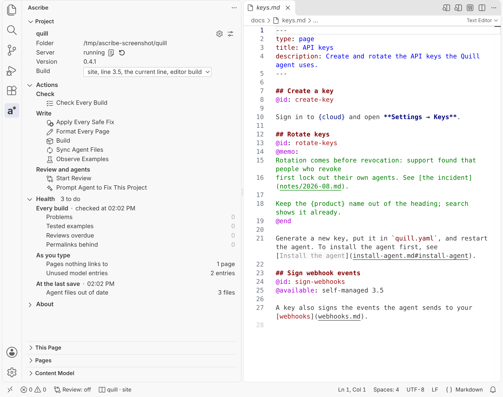
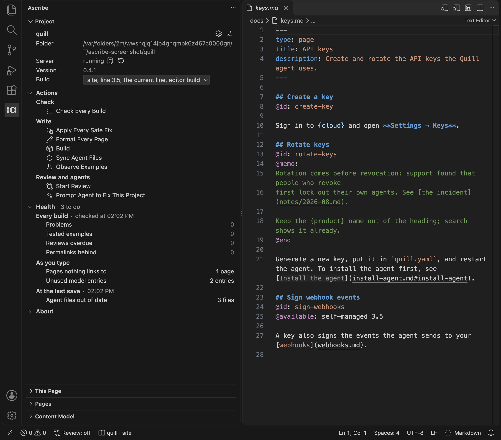
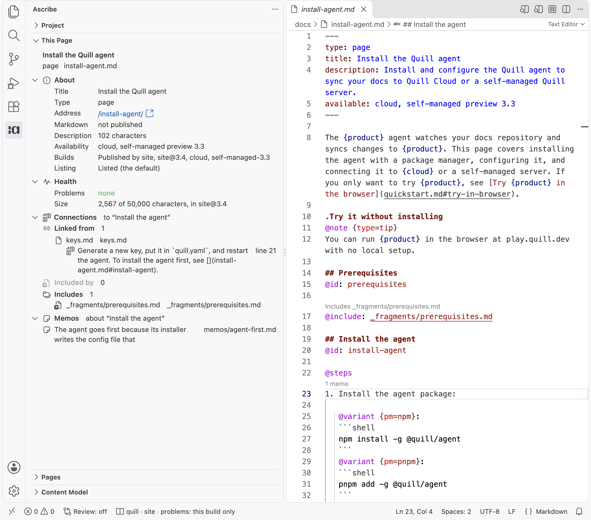
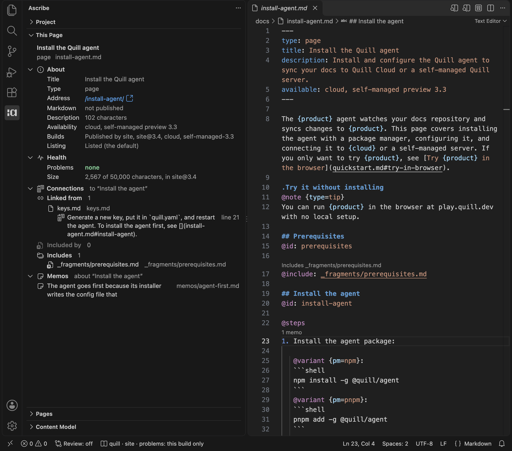
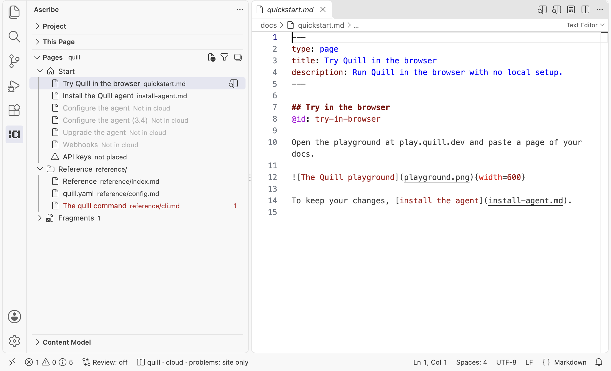
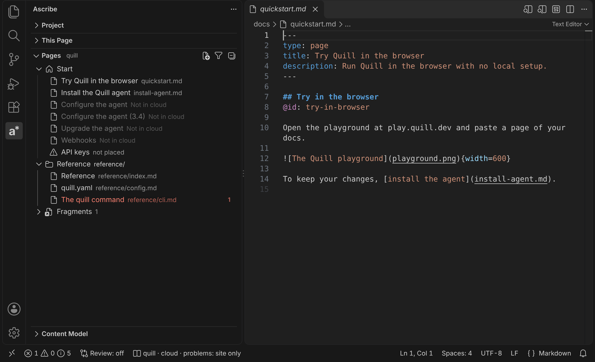
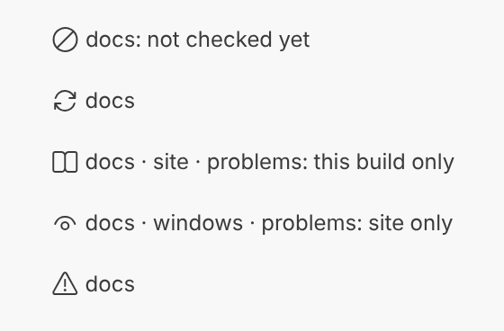
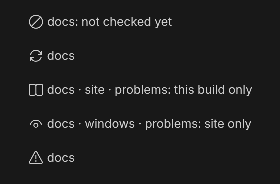

The Ascribe icon in the activity bar opens the Ascribe sidebar. Its views, from the top:

- **[Project](#the-project-view)**: the whole project, its server, its build, its actions, and what needs doing.
- **Review**, while review is on: see [The Review view](review.md#the-review-view).
- **[This page](#this-page)**: what's known about the active page.
- **[Pages](#pages)**: the project's navigation, in its order, and its fragments.
- **[Content model](#content-model)**: what `ascribe.toml` declares, and what uses it.

The views show the active file's project, named beside Pages' and Content model's titles. The [status bar](#the-status-bar) item names it too, with a menu of the Project view's jobs. [When the views update](#when-the-views-update), at the end of the page, has the exact rules for each view.

## The Project view

**Project** is about the whole project, where This page is about one page. It shows the same project as the views below it.

{scheme=light}
{scheme=dark}

At its top:

- **Show Output** and **Restart** do what the [status bar](#the-status-bar) menu's **Show output** and **Restart server** do. They're there once the server has started, so you restart a failed server where you see it.
- **Build** is the build you're looking at, with every build of the project, and each line of a versioned build, to switch to. It's the same choice as the status bar's **Switch build** and the preview's **Build** picker. Switching it in any of them moves the others, the preview, and the [build lens](preview.md#the-build-lens).
- The gear opens [Project Settings](settings.md): the project's `ascribe.toml`, which everyone working on it shares. The button beside it opens VS Code's Settings at Ascribe's, which are yours alone.
- **Switch Project**, in the title bar, is there in a workspace with several projects: see [Switch Project](#switch-project).

Its sections are **Actions**, open at first, then **Health** and **About**. Actions come first so they stay put as Health's counts change. The view has no badge: This page's badge is the one that counts what to do.

**Health** counts what needs doing, in groups by when each count is from. **To do**, in its header, counts the counts above zero. Only the counts that need doing are shown: a group's counts of none are behind a **Nothing else to do** line, and a group with nothing to do is its head alone. A dash means the count isn't known now: the group's head says why, with the action that brings it current. See [Health's counts](#healths-counts).

```text
Health                                   1 to do
  Every build · not checked yet    ▷ Check Every Build
    Problems                  —
    Tested examples           —
    Rechecks overdue           —
    Permalinks behind         —
  As you type
    Unused model entries      5 entries
    › Nothing else to do
  At the last save · 3:30 PM       › Nothing to do
```

| Group | Count | Counts | Opens |
|---|---|---|---|
| **Every build** | **Problems** | What the last **Check Every Build** found, an icon per severity with its count | The Problems panel |
| | **Tested examples** | That check's `example-stale` and `example-unobserved`: examples changed since they were tested, or never tested | The Problems panel, and the first of them in the editor |
| | **Rechecks overdue** | That check's `recheck-overdue` | The Problems panel, and the first of them in the editor |
| | **Permalinks behind** | That check's `permalinks-list-behind` | The Problems panel, and the first of them in the editor |
| **As you type** | **Pages nothing links to** | Pages and fragments nothing links to or includes | Pages, with **Orphans Only** on |
| | **Unused model entries** | Content model entries nothing uses | Content model, with **Unused Only** on |
| **At the last save** | **Agent files out of date** | What `ascribe agents sync --check` reports | **Sync Agent Files**, which names the files it would change and asks first |

**Actions** act on the project the view shows, wherever the cursor is. Each one's tooltip says how it runs:

| Action | How it runs |
|---|---|
| **Check Every Build** | The extension checks every build and puts their problems in the Problems panel |
| **Apply Every Safe Fix** | The language server, as one edit, left unsaved: see [Edits to the whole project](#edits-to-the-whole-project) |
| **Format Every Page** | The language server, as one edit, left unsaved |
| **Build** | A task: `ascribe build`, in the terminal |
| **Sync Agent Files** | A task: `ascribe agents sync`, in the terminal |
| **Observe Examples** | A task: `ascribe observe`, in the terminal, in the folder of a source with [tested examples](../examples/tested.md). It lists the commands `ascribe.examples.toml` names and asks before running them. |
| **Start Review** | As **Ascribe: Start Review**: marks what changed in the preview, against a base it asks for. See [Review in the preview](review.md). |
| **Prompt Agent to Fix This Project** | As **Ascribe: Prompt Agent to Fix This Project**: builds a prompt about the project's problems for your agent, without sending it. See [Prompt your agent](../agents/prompts.md). |

The tasks are in **Tasks: Run Task** too, and [Tasks](settings.md#tasks) says where they run.

**About**, closed at first, says what the project is made of: its content root, its builds, with the editor build marked, the release lines of each versioned build, its [sources](../examples/sources.md), with those that have tested examples marked, and its content types, each with how many pages have it.

### Edits to the whole project

**Apply Every Safe Fix** applies every [safe fix](problems.md#apply-the-safe-fixes) of the problems the editor shows, in every page and fragment of the project. **Format Every Page** formats every page and fragment, as [Format Document](writing.md#formatting) and `ascribe fmt` do. Both are in the Command Palette too, as **Ascribe: Apply Every Safe Fix** and **Ascribe: Format Every Page**, for the active file's project.

Each first says how much it changes and asks: "Apply 6 safe fixes in 4 files? They're left unsaved, to read before you save them." Each opens the files it changes, unsaved, so you can read them first. **File: Save All** saves them, and **Undo** takes the edit back. [How the whole-project edits apply](#how-the-whole-project-edits-apply) has the rest.

### Addresses lost
@available: ascribe 0.4.4

In a project that [keeps its addresses](../publishing/redirects.md), Health has a group after **Every build**, **Against the base**, with one count:

```text
  Against the base · main at 3:30 PM
    Addresses lost            1 page
```

**Addresses lost** counts the pages whose addresses the base published and nothing accounts for now, [`address-lost`](../checks/diagnostics/project-files.md#ASC255). It opens the Problems panel at `ascribe.addresses`, where its problems have their quick fixes. The head says which base it compared with, and when. A project without `ascribe.addresses` has no group. See [When Addresses lost updates](#when-addresses-lost-updates).

## This page

**This page** says what's known about the page you're working in. Its sections are **About**, **Health**, **Connections**, and **Memos**. While review is on, **Review** comes after About ([Review in the preview](review.md#the-review-view)).

{scheme=light}
{scheme=dark}

Only About starts open. The other headers say whether to open them: Health's count of the rows that warn, such as "2 rows warn", Connections' heading, and Memos' "none". The view's badge shows Health's count, so you see it with This page collapsed or Health closed.

- **Connections** lists what links to the page, what includes it, and what it includes. With the cursor under a heading, it narrows to that heading's links and the includes of its section, whichever page they reach it through. Includes stays the page's.
- **Memos** lists the [memo files](actions.md#memo-files) about the heading, or about the page outside any heading, including memos about a block in it. A personal or outdated memo is marked.
- A file in Connections is named, with its folder beside it when it's in one. An include is shown as the page writes it, with the file it reaches beside it when that says more.
- Each item opens its link, include, or memo. An include opens in the editor group beside the page's, with the focus left in the view, and This page stays on the page.

The head at the top shows the page's title, its type ("fragment" for a fragment), and its path, so About doesn't say them again. Every row that can warn is in Health, and says its state first, in the warning color: "changed since it was tested" before an example's address, "too long" before a description's length. Each row that warns is marked with the warning icon.

**About** says what the page is: where it is, and where it's published and listed. **Address** is always there, and **Markdown** for a page. Each other row shows only when it has something to say. A row with somewhere to go opens it:

| Row | Says | Opens |
|---|---|---|
| **Address** | The page's address from the host's root, such as `/guides/install/`; "only where it's included" for a fragment | The page on the live site, when the project names its [`site`](../content-model/output.md#consumer) |
| **Markdown** | Its Markdown version's address, or "not published" | Its Markdown version on the live site |
| **Availability** | The page's own `available` | Nothing |
| **Builds** | "Published by site, agents; left out by cloud", with why in its tooltip | **Switch Build**, to see the page as a build publishes it; **Dim What the Build Leaves Out** shows what that build leaves out of it |
| **Listing** | "Listed (the default)" or "Unlisted, by `[listing.folders]`" | The page's own `listing`, or the rule in `ascribe.toml` |
| **Permalink** | A [permalink](../permalinks/index.md) the page or one of its headings declares, one row each, with its summary in its tooltip | Its `permalink` or its `@id` line |

**Health** has every row that can warn. **Problems** is always there, and **Size** for a page. Each other row shows only when it has something to say, apart from **Description**, which shows "missing" when the page has none:

| Row | Says | Opens |
|---|---|---|
| **Problems** | The page's problems, an icon per severity with its count, or "none" | The Problems panel, kept to the page |
| **Description** | Its length, or "missing" | The field in the frontmatter |
| **Review** | "overdue, since 3 October" or "due in 12 days" | The field |
| **Template** | "2 placeholders left, how-to template": what its [type's template](../templates/index.md#whats-left-to-fill-in) still leaves to fill in | **Go to Next Placeholder** |
| **Size** | "31,200 of 50,000 characters, in site" | Nothing; its tooltip says which build and the limit |
| **Example** | Each [tested example](../examples/tested.md) the page shows, with its state | The file its `@snippet` shows, beside the page |

A fragment has no builds, listing, or size of its own: it's published only where it's included. [This page's rows](#this-pages-rows) has what each row measures and when it warns.

### Old addresses
@available: ascribe 0.4.4

In a project that [keeps its addresses](../publishing/redirects.md), About has an **Also answers at** row after **Markdown** for each old address an entry of `ascribe.addresses` leads to the page. These are the redirects the build writes to it, such as `/docs/guides/my-setup` on a page moved from `guides/my-setup.md`. Its tooltip names the entry. A row goes when the entry does, and an entry you've added and not saved counts.

## Pages

**Pages** shows the project's [navigation](../navigation/index.md) in its order, then the fragments by folder, each with the files that include it. A page shows its [`nav-label`](../navigation/index.md#a-page-s-label), or else its title. Its tooltip counts the links and includes that reach it. **New Page**, in the title bar, starts a page ([Start a page](actions.md#start-a-page)).

{scheme=light}
{scheme=dark}

Its sections start closed. Opening a page selects it in Pages and opens the sections above it, so you see the open page's path.

To change the order, drag a section or a page where you want it, and Pages writes `ascribe.nav`, unsaved. [Or drag them in the editor](../navigation/order.md#or-drag-them-in-the-editor) has how each drag is placed, **Place Here** for a page the file leaves out, and **Rename Label…**.

- A page or fragment with a problem is red for an error and yellow for a warning, as in the Explorer.
- A page the status bar's build leaves out is dimmed, title and icon, as the [build lens](preview.md#the-build-lens) dims text, and says "Not in" and the build's name in place of its path. See [Pages' colors](#pages-colors).
- A page `ascribe.nav` leaves out of its section's order comes last in the section, marked **not placed**.
- A page's menu has **Open Preview to the Side**, also its button; **Copy Link**; **Rename or Move…**; **Find All References**; and **Reveal in Explorer**. A fragment's menu has the last three. [Pages' menus](#pages-menus) says what each does.
- **New Page Here**, in a section's menu, starts a page in its folder ([Start a page](actions.md#start-a-page)).
- **Orphans Only**, the filter button in the title bar, lists only the pages and fragments nothing links to or includes. Choose it again to list everything.

## Content model

**Content model** lists the project's page types, phrases, features, glossary terms, dimensions, note types, widgets, and builds. Each entry but a build counts the places that use it, and a page type counts its pages. An entry nothing uses is marked **unused**, a candidate to remove. Each dimension lists its values.

Clicking an entry or a value opens its declaration in `ascribe.toml`, or a glossary term's heading on its page.

- **Find All References**, in the menu of an entry pages use, lists those uses in a peek at its declaration.
- **Rename…**, on a phrase or a dimension's value, renames it everywhere, as `F2` does in a page.
- **Insert at the Cursor**, on a phrase or a widget, inserts it at the cursor of the project's last Markdown editor.
- **Unused Only**, the filter button in the title bar, lists only the entries nothing uses.

[Content model's entries](#content-models-entries) has the details of each.

## The status bar

While a page or an `ascribe.toml` is the active editor, the status bar names its project and the [build you're looking at](preview.md#the-build-youre-looking-at), with an icon for its language server's state: a slashed circle before a page of the project has opened ("docs: not checked yet"), a spinning arrow while the server starts, a book while it runs, an eye while the build lens dims by a build, and a warning when the server failed. While it runs, it also says which builds the Problems panel covers, such as "problems: this build only". Its tooltip gives the project's folder, its `ascribe.toml`, the `ascribe` binary in use, and the server's state.

{scheme=light}
{scheme=dark}

Click it, or run **Ascribe: Project Menu**, for a menu of the project: **Switch build**, **Check every build**, **Show output**, **Switch project** in a workspace with several projects, **Restart server**, and, for a page, **Dim what the build leaves out** and **Open preview**. The [Project view](#the-project-view) has the same jobs for its project, and each does the same there.

## Switch Project

In a workspace with several projects, **Ascribe: Switch Project** chooses the project the sidebar shows. It's in the Command Palette, the [Project view](#the-project-view)'s title bar, and the [status bar](#the-status-bar) item's menu. With one project, it's in none of them.

It lists every project the editor found, the sidebar's first and marked, each with its folder, its server's state, and its `ascribe` binary. Each has buttons to show its server's output and to restart it.

Choosing a project shows it in the sidebar and starts its server. It's a jump, not a pin: the sidebar stays on it until a file of another project becomes active, then follows that file as before. [The Switch Project list](#the-switch-project-list) has the rest.

## When the views update

This section has the rules behind the views above: which project and page they show, when each count is current, what a row measures, what they show while a server isn't running, and the keys.

### Which project and page they show

The views follow the active editor. They show nothing for a project whose server hasn't started: filling them never starts one.

The Project view follows the file you're in, and stays on its project when you click in it or open a file of no project.

This page shows the last editor of a page that was active. Clicking in the view, or moving to the preview, another view, a panel, or a file that isn't a page, leaves it on its page. When that page's editor closes, it shows the page of the editor that takes its place.

### Health's counts

A group's head says when its counts are from: "checked at 3:30 PM", "checked yesterday at 3:30 PM", "not checked yet", "checking…", "out of date" with why, or why its check couldn't finish. While its counts aren't current, the action that brings them current is at its head, once for the group: **Check Every Build**, or **Check Agent Files**.

A group's counts of none are behind one line under its other counts, **Nothing else to do**, which shows them. A group with nothing to do and nothing out of date is its head alone, with **Nothing to do** at its end. Each stays shown or hidden as you leave it. Shown, a count of none is `0`, dimmed, and opens nothing. A count that isn't current shows a dash, and its group's head says why. A dash is never dimmed, and an out-of-date group has a warning icon, so none and not known never look alike. **To do** counts only the current counts above zero: a group that isn't current isn't a thing to do, and its head says so, with its action.

The view never checks every build by itself, since that can take a few seconds on a large project. Each group goes out of date by its own rule:

- **Every build** goes out of date on any change to a file of the project, saved or not: a page, `ascribe.toml`, `ascribe.nav`, `ascribe.permalinks`, a memo, a template, or a file in one of its [sources](../examples/sources.md)' folders. A check that read files with unsaved changes says so: it reads files as they're saved.
- **Every build** is remembered between sessions, for each project in the workspace. When VS Code opens, the view reads the last check back as it first shows the project, which takes a moment ("reading the last check…"). If no file of the project was modified after the check started, added, or removed, its counts are current, as if it had just run, with its problems back in the Problems panel. If one was, as a `git checkout` or a branch switch does, or a file of the project is open with unsaved changes, they're out of date, "the project changed after the check yesterday at 3:30 PM", with nothing put back. Only names and modification times are compared, so a file put back with its old time isn't seen as a change, and in a source's folder only the files the source reads count. A check made by another version of the extension isn't remembered, nor one with more than 5,000 problems: the project is not checked yet.
- **Problems** counts as the status bar does: an icon per severity with its count, leaving out a severity there's none of.
- **Rechecks overdue** counts for the day the check ran, so it depends on the day as well as the files. When the check is current but from another day, that count alone is a dash, with its own note, such as "checked on 20 October; rechecks fall due by the day", and **Check Every Build** beside it.
- **As you type** comes from the language server, which reads your unsaved text, so its counts are current as you type. **Pages nothing links to** is its list of orphans, as Pages' **Orphans Only** has it, and **Unused model entries** its count of each content model entry's uses, as Content model's **Unused Only** has it. While the server is starting, or isn't running, they show a dash.
- **At the last save**: agent files are made from the content model and the pages, so most saves can change them. The view checks them when it first shows the project, and again after each save of a file of the project while it's showing, at most once every few seconds and never as you type. A change on disk that isn't a save, such as a `git checkout`, makes the count out of date, with **Check Agent Files** at the group's head.

About's builds and content types are the language server's, so they're known once it runs. Its sources are what `ascribe model` says.

### When Addresses lost updates
@available: ascribe 0.4.4

The language server compares the addresses with the base's on its own, between checks: when the project loads, after a save, after a change on disk such as a page deleted in the Explorer or a `git checkout`, and as you edit `ascribe.addresses`, so a move's entry counts before you save it. It doesn't compare as you type in a page. While the server is starting, or when the base can't be read, the count is a dash and the head says why, with the reason in the Problems panel.

The group's problems are in the Problems panel at `ascribe.addresses`, as **Check Every Build** puts them. **Check Every Build** replaces them with its own when it runs, so the same problem is never listed twice, and the server's next comparison replaces the check's.

### How the whole-project edits apply

**Apply Every Safe Fix** applies the safe fixes as **Apply the safe fixes in this page** applies one page's. They're the editor build's problems, the ones in the Problems panel. A problem only another build has, or one that takes every build to tell, is [`ascribe check --fix`](../checks/check.md#applying-the-safe-fixes)'s to fix.

Each edit is one edit to the text the editor has, so a page you've changed and not saved is fixed or formatted as you have it, never as it is on disk. When there's nothing to change, it says so and asks nothing.

The files are left unsaved on purpose: on a large project an edit can change hundreds of files, and you can read each before you save it. When you undo, VS Code asks whether to undo the edit in every file it changed or only in the one you're in. If a file changes while the question before the edit is up, nothing is applied; choose the action again.

### This page's rows

This page updates as you move between pages and headings, while it's open, and unsaved edits count. As the cursor moves and the checks run, it changes what it says in place, keeping its scroll and the row you're on. Its badge goes when you move to another page while the view is collapsed, until you open it again.

A row whose state can warn says the state in the warning color only when there's something to do. The title draws its code spans as code where its type's `title` field reads them ([`inline = "code"`](../content-model/index.md#53-code-in-a-field)). In About:

- **Address** is written as the site output's links write it. It opens the site's origin and the address, in your browser, after VS Code asks about a domain it doesn't trust yet. That's the published site, not your branch: a page that's new or moved on your branch isn't there yet, and the row's tooltip says so. Without a `site`, for a fragment, and where the build the status bar shows leaves the page out, it's text and opens nothing.
- **Markdown** says "not published" when the project publishes no Markdown versions ([`[consumer] agents`](../content-model/output.md#consumer), on by default with a `site`). It opens its Markdown version as Address opens the page. A fragment's address is only where it's included.
- **Builds** names the builds that publish the page and the ones that leave it out.
- **Listing** is what [`pages.json`](../content-model/checks.md#22-listing) says of the page, and the rule that sets it.
- **Permalink**'s tooltip has the summary a product shows with its help, as [`help.json`](../permalinks/in-your-product.md#writing-summaries) writes it in the editor's build: the section's `@summary`, or the page's description for its own. Or it says the section has none, which [`summary-missing`](../checks/diagnostics/content-checks.md#ASC252) reports when it's turned on.

In Health:

- **Problems** is VS Code's problems for the page, counted as the status bar counts them, leaving out a severity there's none of. Its filter's **Show Active File Only** keeps the Problems panel to the page.
- **Description** is shown "missing" where [`page-description-missing`](../checks/diagnostics/content-checks.md#ASC150) reports the page. Its length is its field's default's when the page leaves the field out or empty. It's measured against the 300 characters its line in `llms.txt` reads best under, when the project publishes one, and led by "too long", with a warning, only where [`description-too-long`](../checks/diagnostics/output-checks.md#ASC163) reports it.
- **Review** comes from the field with the [`recheck-date` role](../content-model/index.md#54-field-roles), as [`recheck-overdue`](../checks/diagnostics/content-checks.md#ASC153) compares it with today, with a warning only where that check reports the page.
- **Size** is the page's Markdown in the build where it's largest, measured as [`page-size`](../content-model/checks.md#19-checks) measures it. It's shown always, so a page is seen growing toward the limit, and led by "too large" once it reaches it.
- **Example** is each tested example a `@snippet` of the page shows: its state first, tested, changed since it was tested, or not tested, then its address, what it was tested with, and the heading it's under.

### Pages and Content model

Pages updates when you save a file of the project, when a page is added or deleted, as you edit `ascribe.nav`, and when you switch to another project's file. Content model updates when you save a file of the project, when a page is added or deleted, and when you switch to another project's file.

#### Pages' colors

A page the status bar's build leaves out follows the build as you switch. A problem's red or yellow still shows over its dimming. The dimming is the file's, so the Explorer and the editor's tabs dim it too.

#### Pages' menus

- **Copy Link** copies the page's path from the content root, such as `/guides/install.md`: the link a page writes to it. Its published address is This page's **Address** row.
- **Rename or Move…** asks for its new path and moves it as the Explorer does, the links to it following.
- **Find All References** lists the links and includes that reach it, in a peek at its start.
- **Orphans Only** leaves index pages out, and lists each page or fragment in its section or folder.

#### Content model's entries

- Builds have no count, since pages don't name them. The counts are what **Find All References** lists for the same entry. On a page type, it lists the pages whose `type` names it, at that value.
- **Rename…** asks for the new name and makes the edits `F2` makes, shown in the refactor preview first.
- **Insert at the Cursor** runs **Insert a phrase** or **Insert a widget** with the entry chosen, and the editor comes to the front. Where the cursor is somewhere the action doesn't apply, it says where to put it and changes nothing.

### The Switch Project list

The list leaves out [build output, dependencies, and what git ignores](settings.md#workspaces-with-several-projects). A server's state reads such as "running, site build", "not checked yet", or "failed". The restart button is there when the server is running or failed. **Refresh**, in the list's title, asks the running servers for their builds again. Listing them starts no server. Choosing a project starts its server only if it hasn't started.

### While a server starts, fails, or isn't trusted

- In a workspace with no project, Pages says how to start one.
- A project's language server starts when one of its pages opens, so until then nothing has checked it. While no page of a project is active, the status bar says so, counting the projects when there are several, and its tooltip names them. Otherwise a file that isn't in a project shows nothing.
- In place of a page, This page says when no page is open, and when the page's language server is starting.
- When a project's server fails to start, Pages, Content model, and This page say so, with **Show Output** and **Restart**.
- While the project has several builds and the Problems panel holds the problems of the editor build alone, the status bar's tooltip says what the panel covers. Once you [check every build](problems.md#the-problems-panel), and until something changes, it doesn't.

In Restricted Mode, Ascribe runs nothing, since it would run the project's own `ascribe` binary:

- Pages says how to trust the folder.
- The Project view says so in place of the counts, with **Manage Workspace Trust**, and every action is off until you trust the folder.
- This page says Ascribe isn't checking the folder, with **Manage Workspace Trust**.
- The status bar shows **Ascribe: not checking**, and the Problems panel's "No problems" doesn't mean the project is clean. Click it to manage the folder's trust; once you trust it, Ascribe starts.

### Sections, keys, and screen readers

The Project view's sections stay open or closed as you leave them. In This page, open or close a section and it stays that way on every page.

This page's rows wrap, so each shows all it says at any width, with more in its tooltip. An open section's header stays at the top of the view while you scroll through its rows.

In This page, **Tab**, or **Up** and **Down**, moves between the section headers and the rows that open something. **Enter** or **Space** opens a section or a row. **Escape** puts the cursor back in the page, and in the Project view, back in the editor.

A count of problems, in Health and in This page, has a tooltip that says it in words, such as "2 errors and 1 warning" or "1 warning and advice on 2 lines", and so does a screen reader. A screen reader reads a Health count's dash as its group's note.
