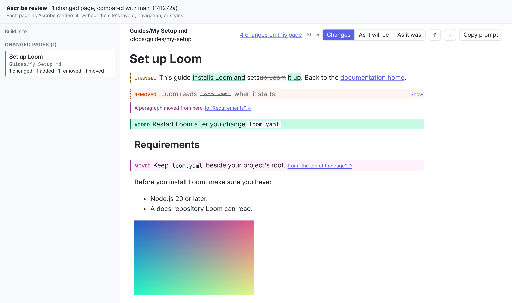
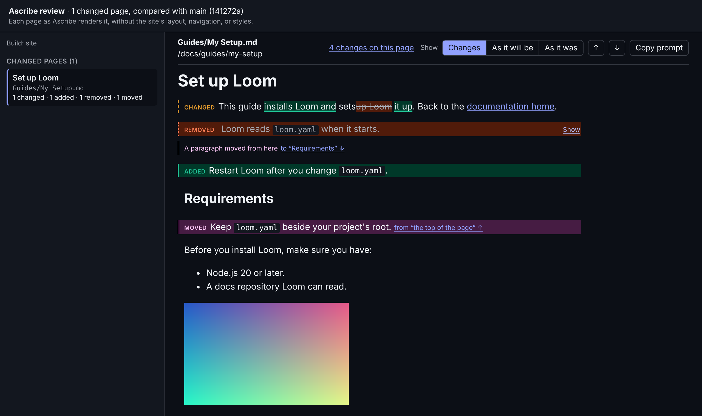

The commands that compare a project with another revision of itself. The options every command accepts are in the [command reference](../command/index.md#options-every-command-accepts).

## `ascribe diff`
@id {permalink=true}: cli-diff
@summary: Shows what changed between a git revision and the working tree, as readers will see it: which pages of each build changed, and which blocks on them were added, removed, changed, or moved.

Shows what changed between a git revision and the working tree, as readers will see it: which pages of each [build](../glossary.md#build) changed, and which blocks on them were added, removed, changed, or moved. It compares **resolved pages**, not files, so a page whose own file didn't change but whose included fragment, [phrase](../glossary.md#phrase), or build settings did is listed, with what its change comes from. A change that doesn't reach the page (`ascribe fmt`, rewrapped lines) isn't.

@include: ../_generated/cli-diff-options.md

The argument is a page, not a revision as in `git diff main`: the revision goes in `--base`. When the argument isn't a file of the project but is a revision git knows, the error says which `--base` compares with it: `ascribe diff main` names `--base main`. `ascribe drift`, which takes no argument, says the same of a revision given as one.

The other side is the working tree: the files on disk, committed or not, as `ascribe build` would read them now. Unsaved editor changes aren't included. The base is read from git, `ascribe.toml` included, so a change to the content model is compared too; if the project didn't exist at the base, every page is added. `ascribe diff` needs `git` on the path, and nothing else: no network and no GitHub account. It runs `git` so that the repository can't make it run a command of its own: with no file system monitor, and taking a bare repository only when one is named, never a folder in the project shaped like one, where `git` says it can't use the repository.

The text output lists each build's changed pages with counts, and where a change comes from when it isn't only the page's own file. A page that changed the same way in every build that publishes it is said once, first, "in every build" (or "in every build that publishes it", when some don't), and each build lists its other pages:

@snippet {lang=text}: code:crates/ascribe-cli/tests/output/diff.txt

A page that moved is listed once, where it is now, when git sees its file renamed (as `git mv` makes it, or a move `git add` has staged) or when [`ascribe.addresses`](../publishing/redirects.md) records the move. It says what it moved from, and what changed on it besides the move, or that nothing did. A page whose link changed only because the page it leads to moved says so; when its own file changed too, the move isn't named again, since the moved page is listed itself:

```text
site: 2 pages changed
  guides/install.md: 1 changed (a link changed because guides/configure.md moved)
  guides/setup.md: moved from guides/configure.md, no change to the page
```

The [lines](../versions/lines.md) of a versioned build are listed together, under the build's name, and a page they share once, with the lines it changed in:

```text
site: 2 pages changed
  install.md: 1 changed, in every line
  upgrade.md: 1 changed, only in 3.4
```

Name a page to see its changes: every changed block, as it was (`-`) and as it is (`+`), with where it's written. In changed prose, the words removed are marked `[-like this-]` and the words added `{+like this+}`, as `git diff --word-diff` marks them; a block that isn't prose, such as a code block, shows its lines on both sides, and a moved block shows its lines once. A build the page didn't change in says so. Name a fragment, or another file pages take text from, to see the pages that changed through it. `--format json` and `--format html` are narrowed the same way, with the same shape and fewer pages, and `--exit-code` exits with `1` only when what's shown changed. A PAGE that isn't a file of the project, at the base or now, is a usage error.

@snippet {lang=text}: code:crates/ascribe-cli/tests/output/diff-page.txt

Pages with errors are compared as they are. When `ascribe check` would find errors for the builds compared, `ascribe diff` says so on standard error, as review does in every place ([When the project has errors](how-it-works.md#when-the-project-has-errors) says why):

```text
warning: the working tree has 3 errors; `ascribe check` lists them
```

### Exit codes
@id: diff-exit-codes

| Code | Meaning |
|---|---|
| `0` | Compared, whether or not anything changed, and whether or not the working tree has errors |
| `1` | With `--exit-code`: something changed |
| `2` | It couldn't run: a usage error, an unknown build, not a git repository, an unknown revision, no merge base (a shallow clone, or unrelated histories), `git` not found, or a project that doesn't load at the base or in the working tree. The reason goes to standard error. |

### The HTML preview
@id: the-html-report

`--format html` writes one HTML file to standard output, with everything in it: its styles and script, the element library, and every image a changed page uses, up to 1 MB each (a larger one shows as a placeholder naming its file). It makes no network requests, so it opens from a CI artifact, an email, or a disk with nothing else:

```sh
ascribe diff --format html > review.html
```

It lists the changed pages of each build, and marks a page that changed only through something it uses ("via `_fragments/prereqs.md`"), and a page that moved with where it moved from, its "As it was" rendered from there; with more than one build changed, a picker switches between them. Each page is rendered as it is now, the way the editor's page preview renders it, without the site's layout, with review's [marks](how-it-works.md#the-marks):

{scheme=light}
{scheme=dark}

Above each page are its file and route, its count of changes, **Show**, which switches between **Changes**, **As it will be**, and **As it was**, and arrows to the previous and next change.

Hovering over a block shows the source file and line it came from (`guides/install.md:12`).

The lines of a versioned build are one build in the list: a changed page is listed once, with "in every line" or the lines it changed in, and a **Line** switch shows it as each line publishes it.

**Copy prompt** copies the page's [agent prompt](diff.md#the-agent-prompt), the one `ascribe diff --format prompt <page>` writes, to paste into your agent. The preview has no link that opens an agent: a file opened from a disk or a CI artifact can't tell which editor you use, so it only copies.

The preview renders at most 300 changed pages; the rest are listed by name, and the preview says so at the top. Each rendered page and image is stored once, however many builds or pages share it. [Attach the HTML preview to every pull request](ci-report.md) has a GitHub Actions job that uploads it.

### The agent prompt

`--format prompt` writes a prompt that asks your agent to review the change as readers will see it, in the [agent prompt format](../agents/commands.md#what-a-prompt-says), and writes nothing when nothing changed. Without a PAGE, it's about every changed page, grouped by build when more than one changed. With a PAGE, it's about that page in the first build it changed in, listing each change with its source lines; for a fragment, or any other file pages changed through, it's about the pages that show it, and asks the agent to check that the new text fits each. A PAGE that isn't a file of the project, at the base or now, is a usage error.

@snippet {lang=text}: code:crates/ascribe-cli/tests/output/diff-prompt.txt

The prompt asks for a report, not edits: a review reads the change, and its author decides what to do. Its paths and commands (`ascribe resolve`, `git diff`, `ascribe diff`) are written from the folder `ascribe diff` was run in, which it names once, with the base, the build, and `--config` as this run had them. The HTML preview's **Copy prompt** gives the same prompt, and the editor's **Prompt agent** gives it from the repository's root.

### Diff JSON

`--format json` writes one JSON document to standard output. It follows the [JSON output](../checks/check.md#json-output)'s rules: `schema_version` changes only when a field is removed or changes meaning, so **ignore fields you don't know**.

| Field | Type | Meaning |
|---|---|---|
| `schema_version` | number | `1` |
| `ascribe_version` | string | The version of `ascribe` that wrote the report |
| `base` | object | `requested`: the revision asked for, or the default branch used. `commit`: the commit it names. `merge_base`: the merge base with `HEAD` that was compared with, or `null` with `--base-exact`. |
| `repository` | object | `root`: the repository's top-level directory. `project_prefix`: the project's folder in it, with a trailing `/`, or `""` at the root. |
| `working_tree_errors` | number | How many errors `ascribe check` finds in the working tree for the builds compared (with the same `--build` options). The comparison runs either way. |
| `blocks_omitted` | boolean | Only with `--pages-only`, and then `true`: each page's `changes` is empty, and its `counts` still count them. |
| `builds` | array | One entry per build compared: `build`, its name, and `pages`, the pages that changed, in path order. |

Each line of a versioned build is an entry of its own in `builds`, such as `site@3.4`, its pages' routes under the line's folder.

Each page:

| Field | Type | Meaning |
|---|---|---|
| `path` | string | The page's path, relative to the content root |
| `moved_from` | string | For a page that moved, its path at the base. The page is listed once, at `path`, with `status` `"changed"`, compared with the page as it was at `moved_from`: its `counts` and `changes` are what differs besides the move, none when it only moved. Absent for a page that didn't move. |
| `route` | string | Its route; for a removed page, the route it had |
| `status` | string | `"added"` (the build publishes it now and didn't), `"removed"`, or `"changed"` |
| `own_file_changed` | boolean | Whether the page's own file changed, or exists on one side only |
| `because` | array of strings | The other changed files its change comes from, relative to the content root: fragments it includes, and pages its links take their text or a heading id from (a link to a page that changed otherwise isn't a cause). Then the [snippets](../writing/directives.md#snippet) whose code changed, by address (`code:service/client.py#connect`). Then the operations of a [declared API](../openapi/index.md) whose spec changed what the page writes for them, an [`@operation`](../openapi/operation.md)'s method, path, summary, or deprecation, or a link's address, each by its spec's path from the project root, `#`, and the fragment the page names it by (`api/openapi.yaml#createWidget`); a spec change the page doesn't show, such as a schema or a description, isn't a cause. `ascribe.toml` comes last when a change to the content model (a phrase's value, a label, a build's settings) is a cause. A page that moved is named once, by its path now. |
| `page_changed` | array of strings | What changed about the page as a whole, besides its blocks: `"title"`, `"frontmatter"` (fields other than `title` and `available`), `"availability"` (the page-level availability, as shown), and `"route"`, in that order. Empty for an added or removed page. A moved page's route moves with it, so `"route"` isn't listed for one. |
| `moved_links` | array | The pages in `because` whose only change is that they moved, each `{from, to}`, its path at the base and now: a link on this page leads to its new address. Absent when there's none. |
| `counts` | object | `changed`, `added`, `removed`, and `moved`: how many changes of each kind |
| `changes` | array | The block changes, in the page's order, each removed block where it was. Empty for an added or removed page, and for a page whose only changes are in `page_changed`. |

Each change:

| Field | Type | Meaning |
|---|---|---|
| `kind` | string | `"changed"`, `"added"`, `"removed"`, or `"moved"` |
| `now` | object | Where the block is written now (absent for a removed block): `source` and `via`, below |
| `was` | object | Where it was written at the base (absent for an added block) |
| `words` | object | For changed prose: `now` and `was`, the ranges of words that differ, as `[start, end]` character offsets (Unicode characters, end exclusive) into `now_text` and `was_text`, the block's text as a reader reads it, with inline HTML's tags and comments removed and whitespace collapsed. Absent when that text is the same (only a link's target or an HTML comment changed, say) or the block is too long to compare word by word. |
| `after` | object | For a removed block, and for a moved block's old place: the block it came after, as it is now. Absent when it was first in its container. |
| `parent` | object | For a removed block, and for a moved block's old place: the block it was inside, as it is now. Absent at the top of the page. |
| `text` | string | For a removed block: its text, whitespace collapsed |

A block is a heading, paragraph, code block, table, list, list item, block quote, directive, container, group, or a group's arm; changes inside a list, a container, or an arm are listed on the blocks inside it, so a one-word change in a step marks that step's paragraph. A line-form directive that renders as an element around the block after it (`@note`, `@steps`, `@details`, a widget) is one block with that block inside it, from the directive's line through the block's last, like the element.

A block's `source` is `<path>:<first>-<last>`: the file its text is written in, relative to the content root with each path segment percent-encoded (except ASCII letters, digits, `-`, `.`, `_`, and `~`), and its first and last lines, from 1. `via` lists the includes it came through, outermost first, each `<path>:<line>`; it's empty for a block written in the page itself. These are the same strings the site output's source anchors carry, so a tool can find a block in a rendered page.

@snippet {phrases=true}: code:crates/ascribe-cli/tests/output/diff.json

How blocks are matched: blocks are compared by their content without positions, so moving a block down the file or rewrapping it is no change. Blocks that didn't stay are paired, in order, with a block of the same kind whose words overlap by at least half, or that keeps its words whole with words added or taken away at one end, as **changed**; a block that matches nothing is **added** or **removed**, and a removed block identical to an added one elsewhere on the page is **moved**. A block over about 2,500 words gets no word ranges, and a list or container with over 1,000 blocks in it that changed is marked changed as a whole.

## `ascribe drift`
@id {permalink=true}: cli-drift
@summary: Lists the pages whose code examples changed while the words around them didn't, and the pages whose examples no longer resolve.

Lists the pages whose code examples changed between a git revision and the working tree, and whether the words around them changed too, and the pages whose examples no longer resolve. A page covers the code it shows, and nothing else: every region it takes a [snippet](../writing/directives.md#snippet) from, and every whole file it takes as one, including its fragments' snippets. It's for CI, where it says which pages a reviewer should reread; see [Report the pages whose examples changed](../examples/drift.md).

@include: ../_generated/cli-drift-options.md

The base is found as `ascribe diff` finds it, and the other side is the working tree. A snippet's region is taken from its file on both sides and compared as text, dedented, with trailing spaces trimmed, so an edit elsewhere in the file, a region that only moved, or a change of indent isn't a change. A renamed file is followed. A region the file didn't have at the base is a new example, not a changed one. Then, for each page with a changed example, it compares the page itself as `ascribe diff` does, apart from its snippets: the page changed when its own file did, or when anything else it uses did, such as a fragment it includes or a phrase in `ascribe.toml`.

The pages come in up to three groups:

@snippet {lang=text}: code:crates/ascribe-cli/tests/output/drift.txt

An example **no longer resolves** when it did at the base and doesn't now: its region was renamed, its file moved, or its source is gone. `ascribe check` fails on it too, but the report names the page so the pull request that broke it says so. A `@snippet` the change adds broken isn't listed; that's `check`'s alone. Of the changed examples, the first group is the one to read: the example updated itself, and nobody changed the sentence that explains it. The second is listed so a reviewer can see the change reached the page. Each example says how many lines were added and removed. With nothing to report, it says `No examples changed.`

A changed example isn't always a changed behavior. The report says what changed and how much, and leaves the judgment to you.

It reads little: one `git diff` listing of the change, and at the base only the files that listing names that a snippet uses. The base's pages are read only when an example changed. `ascribe drift` needs `git` on the path, and nothing else: no network and no GitHub account.

### The summary

`--format markdown` writes Markdown for a CI job's summary: the same groups, each page linked to its route on `[consumer] site` (plain text when there's no `site`), and nothing at all when no example changed, so it can be appended to `$GITHUB_STEP_SUMMARY` on every run.

### Exit codes
@id: drift-exit-codes

| Code | Meaning |
|---|---|
| `0` | Compared, whatever it found |
| `1` | With `--exit-code`: an example no longer resolves, or a page's example changed and the page didn't |
| `2` | It couldn't run: a usage error, an unknown build, not a git repository, an unknown revision, no merge base (a shallow clone, or unrelated histories), `git` not found, or a project that doesn't load at the base or in the working tree. The reason goes to standard error. |

### Drift JSON

`--format json` writes one JSON document to standard output, with the [JSON output](../checks/check.md#json-output)'s rules: `schema_version` changes only when a field is removed or changes meaning, so **ignore fields you don't know**.

| Field | Type | Meaning |
|---|---|---|
| `schema_version` | number | `1` |
| `ascribe_version` | string | The version of `ascribe` that wrote the report |
| `base` | object | As in the [diff JSON](diff.md#diff-json): `requested`, `commit`, and `merge_base` |
| `repository` | object | As in the diff JSON: `root` and `project_prefix` |
| `pages` | array | Every page with an example that changed or no longer resolves, in path order |

Each page:

| Field | Type | Meaning |
|---|---|---|
| `path` | string | The page's path, relative to the content root |
| `route` | string | Its route, in the first build that shows it |
| `builds` | array of strings | The builds that show it with a changed example |
| `page_changed` | boolean | Whether the page changed apart from its examples, in any of those builds. With `false`, its changed examples are in the group to read. |
| `examples` | array | The examples that changed, by address |
| `broken` | array | The examples that resolved at the base and don't now, by address: `address`, `source`, `problem` (the slug `ascribe check` reports, such as `snippet-region-missing`), and `reason`, in a few words |

Each example:

| Field | Type | Meaning |
|---|---|---|
| `address` | string | The snippet's address, as the page writes it (`code:service/client.py#connect`) |
| `source` | string | The source it names |
| `file` | string | The code file, relative to the repository's root |
| `was_file` | string or null | The code file at the base, when it was renamed since |
| `added` | number | Lines only in the code now |
| `removed` | number | Lines only in the code at the base |
