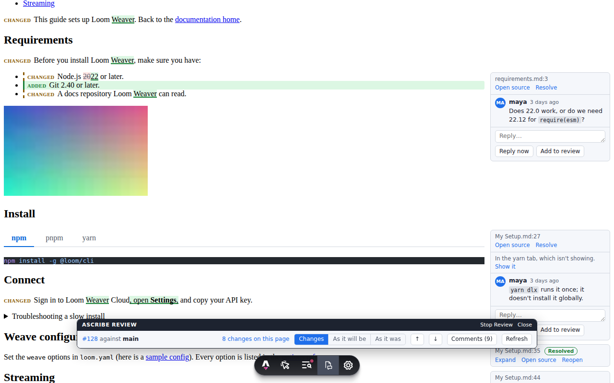

Ascribe shows a pull request the way readers will see it: each page it changes, rendered, with the changed blocks marked, and the pull request's review comments beside the blocks they're about. You read the change as pages instead of as a diff of Markdown files, comment where you're reading, and your comments land in the pull request like any other review.



You can review in three places, and they show the same changes and the same comments:

- the **page preview** in VS Code, which renders the page by itself and needs nothing but the extension;
- the **site preview**, the page in your real site, from `astro dev` with [`@ascribed/astro`](../astro/index.md);
- the **report**, one HTML file that CI can attach to every pull request, for anyone who wants to read the change without a checkout: [Attach the review report to every pull request](ci-report.md).

[How review works](how-it-works.md) says what review compares, what its marks mean, and how its comments map to the pull request.

## Review a pull request

You need a checkout of the pull request's branch, VS Code with the [Ascribe extension](../editor/index.md#install), and, for comments, a GitHub account that can comment on the pull request.

### 1. Check out the branch

```sh
gh pr checkout 128
```

or `git fetch` and `git switch` to the branch. Review finds the pull request from the branch you're on, so the branch has to track the one on GitHub.

### 2. Start review

Open the folder in VS Code, open any page of the project, and run **Ascribe: Start Review** from the command palette, or choose **Review: off** in the status bar.

Review looks for the branch's pull request and asks what to compare with. Choose **The base of pull request #128**: it compares with the point where the branch left its base, as GitHub does.

The first time, VS Code asks you to sign in to GitHub. Allow it to see comments. If you decline, review still marks the changes ([Signing in to GitHub](how-it-works.md#signing-in-to-github) has the other ways in).

### 3. Read the changed pages

Run **Ascribe: Changed Pages**, also the list button in the preview's title bar, to list every page the pull request changes. Choose one to open it and its preview.

@available: ascribe 0.4.0
The **Review** view, first in the Ascribe sidebar while review is on, lists the same pages with their counts and open threads ([The Review view](../editor/review.md#the-review-view)). Choose a page there to open it and its preview at its first change.

In the preview, step through the changes with the header's arrows, and switch between **Changes**, **As it will be**, and **As it was** to read the page with and without the [marks](how-it-works.md#the-marks). Click a mark's label to open its source lines.

### 4. Comment

The pull request's comments sit beside the blocks they're about.

- **To comment on a block,** point at it or move to it with the keyboard and choose **Comment**. Write the comment and choose **Add to review**. It's unsent until you submit.
- **To reply,** open the thread and write a reply. **Add to review** keeps it with your unsent comments; **Reply now** sends it at once, while you have none.
- **To resolve a thread,** choose **Resolve**. **Reopen** undoes it.

To hand a comment to your agent, choose **Prompt agent** on its thread ([In review](../agents/index.md#in-review)).

### 5. Submit

Choose **Submit review…** in the bar at the bottom of the preview. Check the comments it lists, add a summary if you want one, and send them as a comment, an approval, or a request for changes.

After you submit, the comments are on the pull request on GitHub, from you, like any review.

### Review in the site preview

The page preview shows the page alone. To review the page in your site's own layout, navigation, and styles, start the site's dev server on the same checkout:

```sh
gh auth login   # once
npx astro dev
```

Open the site in your browser and choose the **Ascribe review** app in Astro's dev toolbar, at the bottom of the page: opening it starts review. Its panel has the same controls as the page preview's header, and comments, replies, resolving, and submitting go into the same review on GitHub. [Review in the site preview](site-preview.md) has the panel in full.

From VS Code, **Ascribe: Open Site Preview** opens the page you're editing on the dev server.

## See also

- [](how-it-works.md): what review compares, the marks, how comments map to the pull request, and what reaches GitHub.
- [](troubleshooting.md): when review shows no pull request, no comments, or no marks, or won't start.
- [](../editor/review.md): the page preview's review controls, and the Review view.
- [](site-preview.md): the site's side of review.
- [](ci-report.md): the report from CI.
