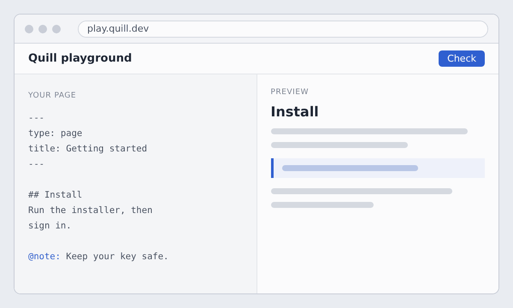

Try {product} on a page of your own docs before you install anything.

## Try in the browser
@id: try-in-browser

Open the playground at play.quill.dev and paste a page of your docs.

{width=600}

To keep your changes, [install the agent](install-agent.md).
