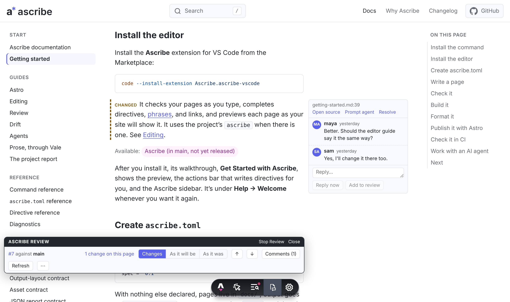
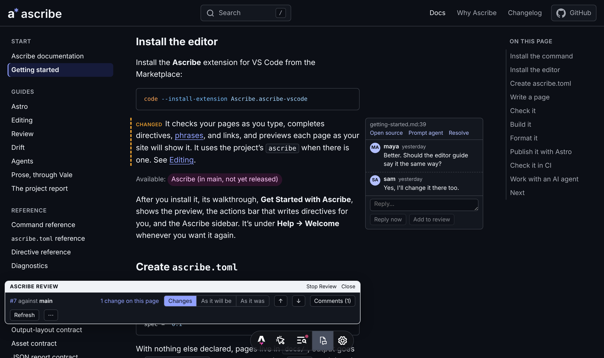

@hero-banner {status=early}:
# Docs as code, with the tools docs need.

Ascribe is a toolchain for documentation written as code: Markdown with the structure docs need, checked as you write, and built into a website, plain Markdown, and JSON.

@tool-list:
- [Reusable content](#tools)
- [Variants](#tools)
- [Versions](#tools)
- [Page types](#tools)
- [Templates](#tools)
@end

@call-to-action:
@memo: Start installs the same command, and scripts/docs-site/facts.test.ts fails when either differs from getting started's.
```sh
npm install --save-dev @ascribed/cli
```

[Read getting started]({site}/go/getting-started/)
@end

{scheme=light}
{scheme=dark}
@end

## A page, and what readers see

A page's source, read from its file in Ascribe's repository, and the page this site builds from it. The note, tabs, and steps are Ascribe directives.

@source-and-result {page=install}:
@snippet {lang=markdown, title=install.md}: code:site/demo/content/install.md
@end

## The tools of a docs team
@id: tools
@story-pillar

@pillar-proof:
- [Reuse]({site}/go/directives/) with `@include` and phrases.
- [Variants]({site}/go/variants/) by platform, product, or package manager with `@variant`, shown as tabs.
- [Availability and versions]({site}/go/versions/): one source, a build for each release line.
- A [glossary]({site}/go/glossary/) that links terms to their definitions.
- [Page types and templates]({site}/go/content-model/), from a content model in `ascribe.toml`.
- [Notes, steps, and details]({site}/go/directives/).
- A [page preview and a site preview]({site}/go/preview/) in VS Code.
- [Permalinks]({site}/go/permalinks/) that keep working when a section moves.
@end

@proof-example:
@variant {pm=npm}:
```sh
npx ascribe build
```
@variant {pm=pnpm}:
```sh
pnpm exec ascribe build
```
@end

The command above is marked with `@variant`. The site shows it as tabs, and the plain Markdown and JSON label each version.
@end

## Checked like code
@id: checks
@story-pillar

@pillar-proof:
### Checked

Includes, variants, and page types are part of the Markdown, so one compiler checks them in the editor, on the command line, and in CI. A broken include or link is underlined as you type, like a misspelled import. Here is [`ascribe check`]({site}/go/cli-check/) on the page getting started writes, which links to a page that doesn't exist yet.

[Vale]({site}/go/cli-vale/) can check the prose, too.
@end

@proof-example:
@snippet {lang=text}: code:crates/ascribe-cli/tests/output/getting-started-check.txt
@end

@pillar-proof:
### Examples from real code

With `@snippet`, a code example is read from the code's own file each time a page is checked or built, so it changes when the code does. On a pull request, [`ascribe drift`]({site}/go/cli-drift/) lists the pages whose examples changed, so someone can reread the text around them.
@end

@proof-example:
@snippet {lang=text}: code:crates/ascribe-cli/tests/output/drift.txt
@end

@pillar-proof:
### Reviewed as pages

Review a pull request as rendered pages, in the site's preview or VS Code's, with each change marked and each comment beside its paragraph. [Review]({site}/go/review-guide/) shows how.
@end

@proof-example:
{scheme=light}
{scheme=dark}
@end

## Built for AI agents, writing and reading
@id: for-agents
@story-pillar

@pillar-proof:
### As writers

- The project's rules from [`ascribe agents sync`]({site}/go/cli-agents-sync/).
- The model and the checks through the [MCP server]({site}/go/cli-mcp/).
- A [hook]({site}/go/cli-agents-hook/) that checks after each edit.
- [Memos]({site}/go/memos/) keep the reason a page is written its way, for the next person or agent who changes it.

### As readers

- [`llms.txt`]({site}/go/publish-for-agents/).
- A [Markdown version]({site}/go/publish-for-agents/) of every page.
- Each permalink's [help as JSON]({site}/go/astro-reference/).
- An [index of the docs]({site}/go/cli-agents-index/) written into the product's `AGENTS.md`.
@end

@proof-example:
@snippet {lang=markdown, title=AGENTS.md}: code:crates/ascribe-cli/tests/output/agents/quill/AGENTS.md.snap

What [`ascribe agents sync`]({site}/go/cli-agents-sync/) writes into an example project's `AGENTS.md`.
@end

@audience-list:
## For engineers, writers, and agents

Where to start depends on what you do.

@audience-entry:
### Engineers

Start with [checked like code](#checks).

Writing tools in the editor, repository, and CI you already use.

[The path for engineers]({site}/go/for-engineers/)
@end

@audience-entry:
### Writers

Start with [the tools of a docs team](#tools).

Reuse, variants, versions, and preview, in the same repository as the engineers who review your pages.

[The path for writers]({site}/go/for-writers/)
@end

@audience-entry:
### Agents

Start with [the rules, the checks, and the outputs](#for-agents).

An agent writing pages gets a check to run that always gives the same answer. An agent reading them gets Markdown and an index instead of HTML.

[The path for agent builders]({site}/go/for-agent-builders/)
@end
@end

## Start
@memo: Getting started's first two sections install these two (decision 86 in project-docs/decisions.md), and scripts/docs-site/facts.test.ts fails when the commands here, or the hero's, differ from theirs.

@call-to-action:
@steps
1. Install the command in your project's folder:

   ```sh
   npm install --save-dev @ascribed/cli
   ```

2. Install the VS Code extension:

   ```sh
   code --install-extension Ascribe.ascribe-vscode
   ```

Then follow [getting started]({site}/go/getting-started/) to set up a project and publish a first page.

[Read getting started]({site}/go/getting-started/)
@end

@quiet-pillar:
## Plain files you can leave

- A page is a Markdown file.
- The [plain Markdown output]({site}/go/cli-build/) is CommonMark, with includes and phrases filled in.
- Ascribe hosts nothing and calls no model.
- It's open source under the MPL.

[Why Ascribe](why.md) covers the problems Ascribe solves, and what it doesn't do.

## Early, and open source

Ascribe is before 1.0, so a release can still change behavior. Pin the version. The latest release is {version}. The code, the docs, and the plans are on [GitHub](https://github.com/ascribed-dev/ascribe), under the Mozilla Public License 2.0.

Ascribe is made by [Bryo Studio](https://bryostudio.com). [Credits](credits.md) says what it's built on.
@end
