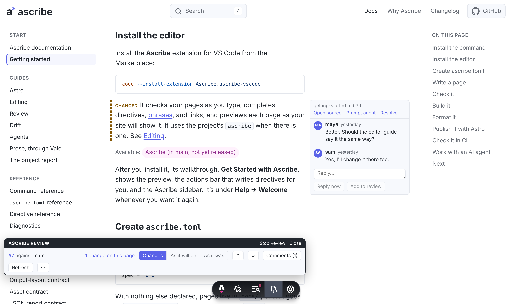
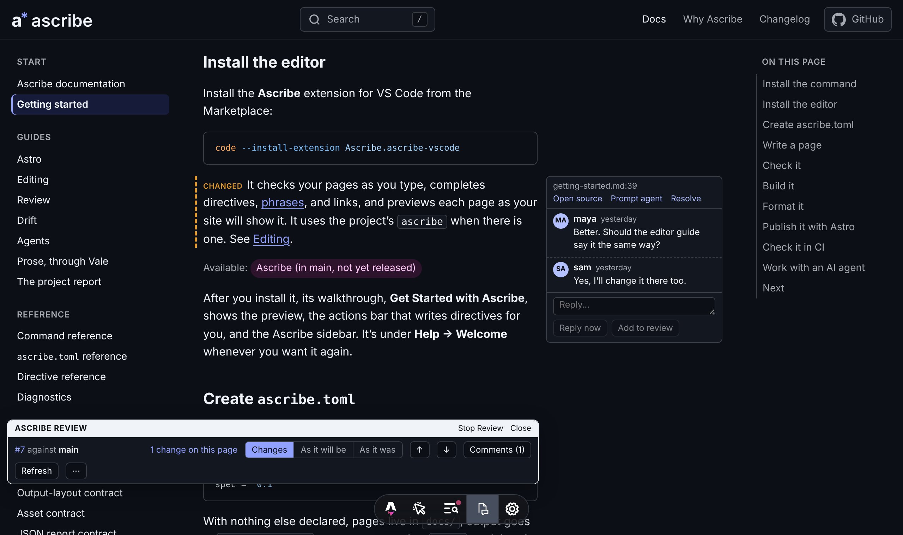
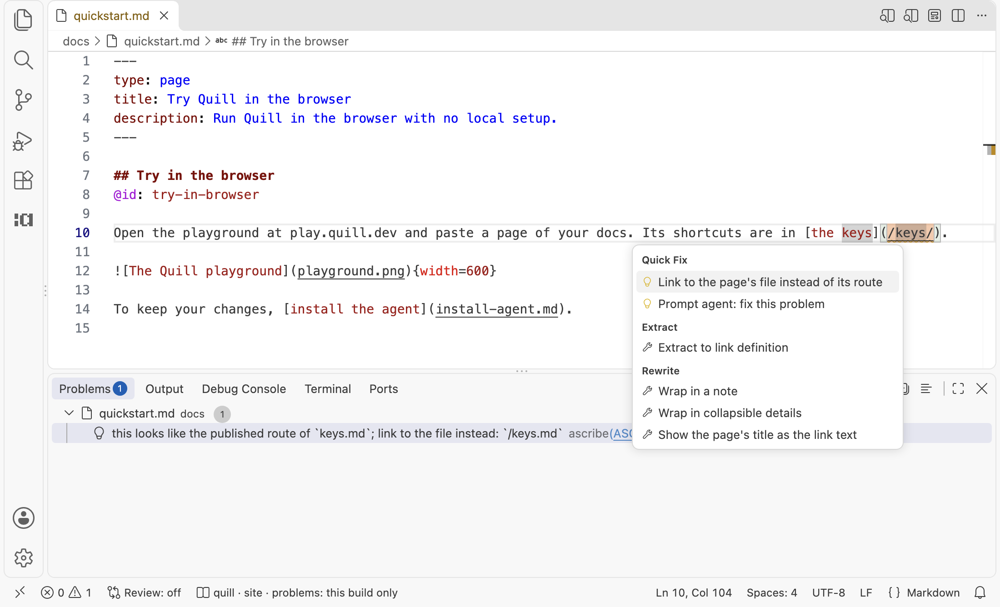
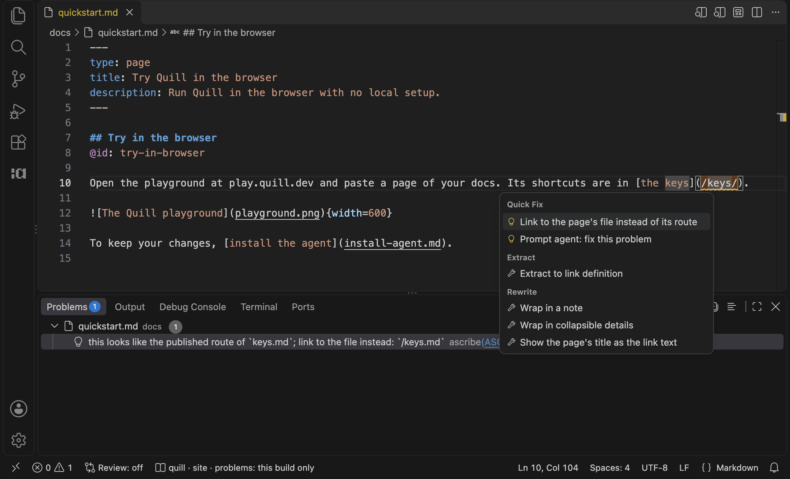

@hero-banner:
# Why Ascribe

Teams that keep their documentation in a repository, beside the code, report the same few problems. This page says what they are, what Ascribe does about each, and what it doesn't do.
@end

## What teams report, and what Ascribe does

The problems come from research into what documentation teams report: surveys, the records of open-source projects, and the accounts of people who write and review docs as code. The answers are what Ascribe does today, and what's in `main` and in no release yet is marked.

@claim-example:
### Examples stop matching the code

Keeping documentation in step with the product is the challenge surveys of documentation teams name most often, and engineers name it more often than writers do. Keeping the docs in the code's repository doesn't settle it: a study of the 1,000 most popular projects on GitHub found that more than a quarter had an outdated reference to code in their README or wiki. The fixes developers say they trust are structural ones, such as examples taken from code that's tested.

Ascribe reads a code example from the code's own file with `@snippet`, every time it checks or builds a page, so there's no copy to fall behind, and `ascribe check` reports an example whose file or region is gone. When a pull request changes code, [`ascribe drift`]({site}/go/cli-drift/) lists the pages whose examples changed, so someone rereads the words around them:

@snippet {lang=text}: code:crates/ascribe-cli/tests/output/drift.txt
@end

@claim-example:
### A review shows lines, not the page

On a pull request, a reviewer can read the rendered page or comment on a line of its source, but not both, and people have built browser extensions to work around it. Reading prose as lines has costs teams describe: text that moved reads as text that was deleted, and a small edit to a wrapped paragraph shows as a change to all of it. Writing with AI adds to the load. Teams that use it report spending more time checking and editing what it writes, so more of the work is now reading changes.

Ascribe compares pages as readers will see them, not lines. [Review]({site}/go/review-guide/) shows a pull request's changes on the rendered page, in VS Code's preview or in the site's own, with what changed marked and the pull request's review comments beside the blocks they're about. Reformatting isn't a change, a move is shown as a move, and a page that changed only through a fragment it includes is listed with the cause.

Here is the site's preview of one of these docs' pages, with a pull request's change and the comments on it:

{scheme=light}
{scheme=dark}

[`ascribe diff`]({site}/go/cli-diff/) writes the same comparison as text, or as an HTML file that CI can attach to the pull request:

@snippet {lang=text}: code:crates/ascribe-cli/tests/output/diff.txt

An AI coding agent can run the checks you run. [`ascribe agents sync`]({site}/go/agents-guide/) gives it the project's rules and the check to run after each edit, so its change reaches review with its links, names, and examples already checked.
@end

@claim-example:
### One page, copied for each version

Teams that keep a copy of their docs for each version of the product report what it costs: authors edit the wrong copy, and a fix made in one has to be carried to each of the others, often as a pull request per version. Most documentation markup has no way to say that a section applies from version 3.4 on, which is what would let one copy serve them all.

Ascribe keeps one copy. A section says where it's available, as `@available: cloud, self-managed preview 3.4` does, and content that differs by platform, product, or deployment is marked once, with `@variant`. Each build is a selection from the same pages: the site can show everything, with badges and tabs, while another build keeps only what one deployment or version has. These are the builds of an example project:

@snippet {title=ascribe.toml}: code:examples/content-models/full.toml#builds

`ascribe check` reports a version or a value the content model doesn't declare, and a section that says it's available somewhere its page isn't.
@end

@claim-example:
### A link breaks when a page moves

When docs are reorganized, a page's old address goes away. Links from other pages, from search results, from the product, and from what AI tools learned before the move still point at it. Of the docs tools the research looked at, one creates a redirect when a page moves.

In Ascribe, a link names the page's file, not its address. A link to a file or a heading that isn't there is an error, in the editor and in CI, and moving or renaming a file in VS Code updates the links to it. A link written as an address is reported, with the file to link to instead:

@snippet {lang=text}: code:crates/ascribe-cli/tests/output/check.txt

In VS Code, the warning is on the link as you type, with a quick fix that makes the change:

{scheme=light}
{scheme=dark}

For links from outside the docs, a page or a heading can have a [permalink]({site}/go/directives/): a name, at an address that leads to it wherever it moves. With the list of permalinks committed, `ascribe check` warns when one goes away. Ascribe's command and editor link to these docs by permalink, which is how the docs moved to `/docs/` without breaking those links.
@end

@claim-example:
### Pages that are code, and a toolchain to keep

Teams that build their own docs site describe its upkeep as work nobody is funded for. Site generators stop releasing or change their plugin systems, sites move from one generator to the next, and where a page is compiled as code, as MDX pages are, an ordinary brace or angle bracket in a sentence can stop the build.

An Ascribe page isn't code. A directive is a line that starts with `@`, and there's no JSX, so a brace or an angle bracket in a sentence doesn't stop the build: at most, a `{name}` the project doesn't declare gets a warning. The pages read as Markdown without Ascribe, and the [plain output]({site}/go/cli-build/) is ordinary CommonMark, so leaving Ascribe means building once more, not rewriting. Ascribe is a dependency too, and a young one. What it lowers is the cost of leaving, not the risk of depending.
@end

## What it doesn't do

- **No hosting.** Ascribe builds files, and the site is served by whatever serves it now. Review comments are the pull request's own, on GitHub, so there's no service of Ascribe's to sign in to or to run.
- **No model.** Ascribe calls no AI model and holds no key for one. Its checks are rules, with the same answer on every run, and an agent you already use runs them.
- **No check that the words are true.** A page that's well formed and says something false passes every check. `ascribe drift` says which pages to reread when their examples change; it can't tell that behavior changed behind code that didn't.
- **No navigation in the content model yet.** The order of a site's pages and their groups are the site's to say. Ascribe's own site lists its pages by hand, with a test that fails when one is missing. An order and groups in `ascribe.toml` are an idea for later, with nothing built.
- **One site generator.** The site output is made for Astro, through `@ascribed/astro`. The plain Markdown and JSON outputs work with anything that reads them, but a site that draws Ascribe's tabs, notes, and badges is an Astro site today.
- **No lighter pull request.** A change is still a branch and a pull request. Ascribe makes a pull request easier to read and to check, not to open.
- **No translations.** A project is written in one language. A translation can be a second project, under its own base path, but nothing says which of its pages are behind the source; that's an idea for later.

## The same page in other formats

[`examples/comparison`](https://github.com/ascribed-dev/ascribe/tree/main/examples/comparison) holds one page written four ways: as Ascribe writes it, and as three open-source documentation sites write theirs, with a table of how each says the same thing. `ascribe check` passes on the Ascribe version, and a test runs it on every change.

## Try it

[Getting started]({site}/go/getting-started/) sets up a project, writes a first page, checks it, and publishes it. The [landing page](index.md) shows a page's source beside what a reader sees.
