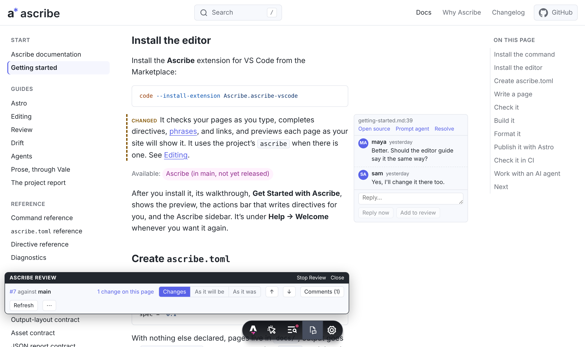
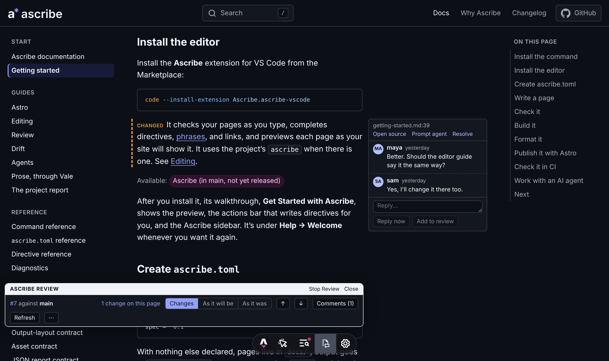
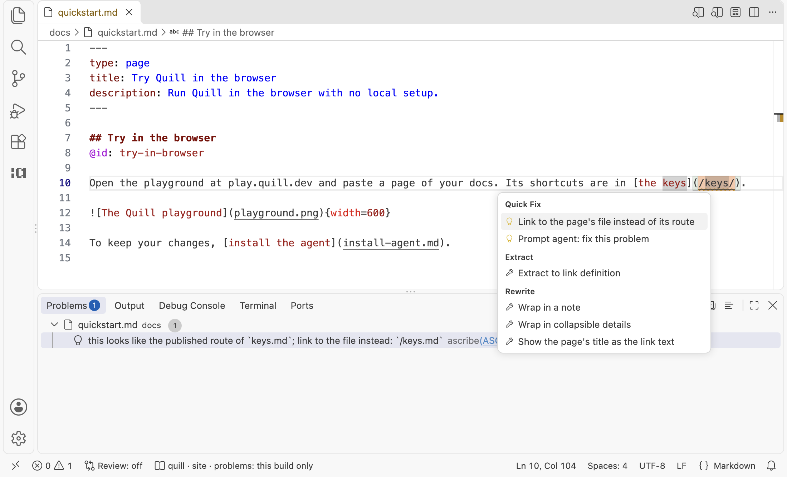
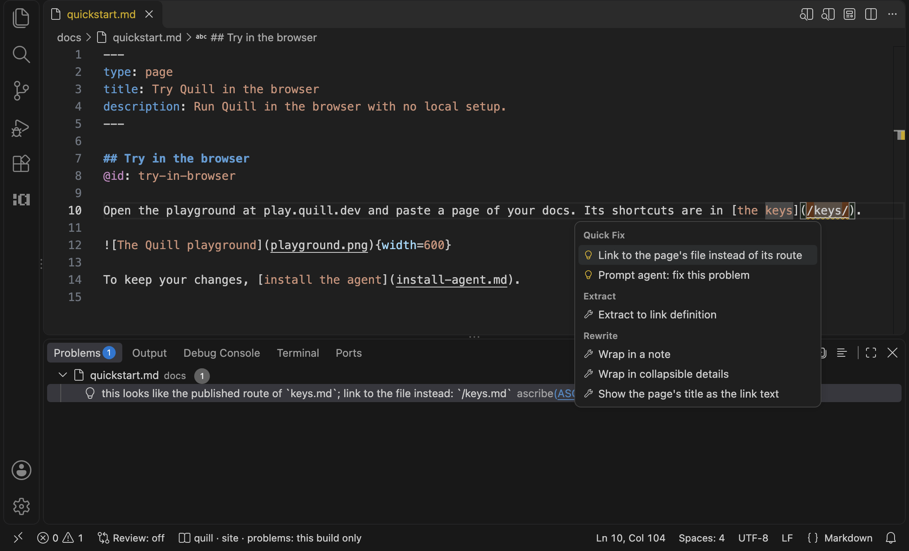

@hero-banner:
# Why Ascribe

Docs kept as code, in a repository beside what they document, run into the same few problems. Here's what Ascribe does about each, and what it doesn't do.
@end

## The problems, and what Ascribe does

Claims about what teams report link to their sources. Anything in `main` that isn't in a release yet is marked.

@claim-example:
### The structure lives in the site generator

Markdown has no standard way to reuse content or to vary it, so each site generator has its own include syntax. The editor treats it as text, and a mistyped include is found when the build fails.

Ascribe puts includes, variants, and page types in the Markdown, defined by a [specification](https://github.com/ascribed-dev/ascribe/blob/main/SPEC.md). One compiler checks them in the editor, on the command line, and in CI. The note, tabs, steps, and phrases on this page are all Ascribe's:

@snippet {lang=markdown, title=install.md}: code:site/demo/content/install.md
@end

@claim-example:
### Examples stop matching the code

Keeping docs in sync with the product is the challenge documentation teams name most often ([State of Docs 2026](https://www.stateofdocs.com/2026/docs-and-product)). Keeping the docs beside the code doesn't fix it: 28.9% of the 1,000 most popular projects on GitHub had an outdated code reference in their README or wiki ([Tan, Wagner, and Treude, 2023](https://arxiv.org/html/2307.04291)).

With `@snippet`, a code example is read from the code's own file each time a page is checked or built, so there's no copy to fall behind. `ascribe check` reports an example whose file or region is gone, and [`ascribe drift`]({site}/go/cli-drift/) lists the pages whose examples a pull request changed:

@snippet {lang=text}: code:crates/ascribe-cli/tests/output/drift.txt
@end

@claim-example:
### A review shows lines, not the page

On GitHub, a reviewer can read a Markdown file rendered or comment on its source, but not both ([GitHub Community](https://github.com/orgs/community/discussions/186730)). Read as lines, moved text looks deleted, and a small edit to a wrapped paragraph looks like a rewrite ([Sarah Moir, 2024](https://thisisimportant.net/posts/docs-as-code-broken-promise/)). AI drafting adds to the reading: in [State of Docs 2026](https://www.stateofdocs.com/2026/docs-and-professional-development), 43% of respondents said they spend more time fact-checking.

[Review]({site}/go/review-guide/) shows a pull request's changes on the rendered page, in VS Code's preview or the site's, with each change marked and each comment beside the block it's about. Reformatting doesn't count as a change, a move shows as a move, and a page that changed through a fragment it includes says so.

{scheme=light}
{scheme=dark}

[`ascribe diff`]({site}/go/cli-diff/) writes the same comparison as text, or as an HTML file that CI can attach to the pull request:

@snippet {lang=text}: code:crates/ascribe-cli/tests/output/diff.txt

An AI coding agent can run the same checks. [`ascribe agents sync`]({site}/go/agents-guide/) gives it the project's rules and a check to run after each edit, so its links, names, and examples are checked before review.
@end

@claim-example:
### One page, copied for each version

A copy of the docs for each version of the product means edits land in the wrong copy, and each fix has to be carried to every other copy. Markdown can't say that a section applies from version 3.4 on, which is what would let one copy serve every version.

Ascribe keeps one copy. A section says where it's available, as `@available: cloud, self-managed preview 3.4` does, and content that differs by platform, product, or deployment is marked with `@variant`. Each build selects from the same pages: the site can show everything, with badges and tabs, while another build keeps only one deployment or version. These are the builds of an example project:

@snippet {title=ascribe.toml}: code:examples/content-models/full.toml#builds

`ascribe check` reports a version or value the content model doesn't declare, and a section marked available somewhere its page isn't.
@end

@claim-example:
### A link breaks when a page moves

When docs are reorganized, a page's old address goes away, but links from other pages, search results, and the product still point to it.

In Ascribe, a link names the page's file. A link to a missing file or heading is an error in the editor and in CI, and moving or renaming a file in VS Code updates the links to it. A link written as an address is reported, with the file to link to instead:

@snippet {lang=text}: code:crates/ascribe-cli/tests/output/check.txt

In VS Code, the warning shows on the link as you type, with a quick fix:

{scheme=light}
{scheme=dark}

For links from outside the docs, a page or heading can have a [permalink]({site}/go/directives/): a name whose address follows it wherever it moves. With the list of permalinks committed, `ascribe check` warns when one goes away. Ascribe's command and editor link to these docs by permalink, which is how the docs moved to `/docs/` without breaking those links.
@end

@claim-example:
### Pages that are code, and a site to keep

Free site generators are cheap to adopt and costly to maintain ([Write the Docs, May 2024](https://www.writethedocs.org/blog/newsletter-may-2024/)). Generators stop releasing or change their plugin systems, and where a page is compiled as code, as an MDX page is, a brace or angle bracket in a sentence can break the build.

A directive is a line that starts with `@`, and there's no JSX, so a brace or angle bracket in a sentence can't break the build. At most, a `{name}` the project doesn't declare gets a warning. The [plain output]({site}/go/cli-build/) is CommonMark, so you can take your content with you, though the reuse is flattened into each page. Ascribe is still a young dependency.
@end

## What it doesn't do

### By design

- A page can't run JSX components. Directives cover notes, tabs, and steps.
- A block directive ends with `@end`, because whitespace never carries meaning.
- There's no visual editor or CMS. Pages are files, and changes are pull requests.
- Ascribe hosts nothing. Whatever serves your site now serves it.
- Ascribe calls no AI model. Its checks are rules that give the same answer every run.
- Nothing checks that the words are true. A well-formed page that says something false passes.
- A section is a folder, so a sidebar can't list a page twice ([Navigation]({site}/go/navigation/)).

### For now

- Ascribe is before 1.0, so a release can still change behavior. Pin the version.
- One person maintains it, part time.
- `@ascribed/astro` is the only site integration. The output format is documented, so others can be added.
- The full editor is VS Code. Other editors get the checks through the language server.
- Review comments work on GitHub. The comparison works in any git repository.
- There's no migration tool, no translation support, and no built-in search.
- It runs on macOS on Apple silicon, Linux with glibc {glibc} or later, and Windows. The npm package needs Node {node}. See [Install]({site}/go/install/).

## The same page in other formats

[`examples/comparison`](https://github.com/ascribed-dev/ascribe/tree/main/examples/comparison) has one page written four ways: in Ascribe, and as three open-source documentation sites write theirs, with a table of how each says the same thing. A test runs `ascribe check` on the Ascribe version on every change.

## Try it

[Getting started]({site}/go/getting-started/) sets up a project, writes a first page, checks it, and publishes it. The [landing page](index.md) shows a page's source beside what a reader sees.
